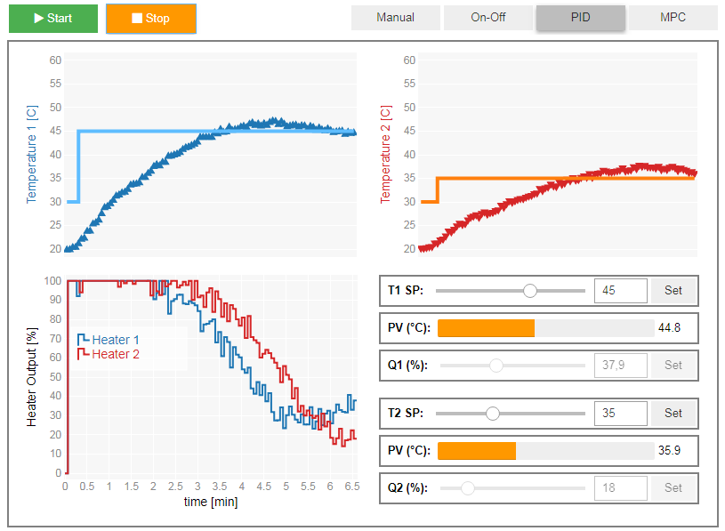
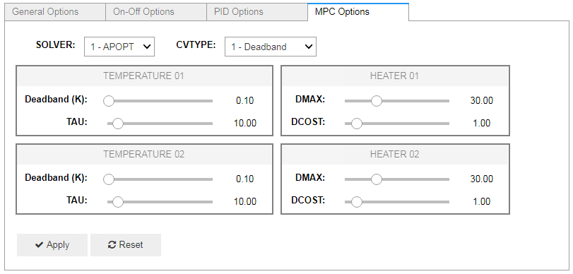

[](https://opensource.org/licenses/MIT)

# tclab_jupyter

A Jupyter-based application and library to explore different control techniques for a simple temperature plant.

## Overview

This project was written to showcase the Arduino-based Temperature Control Lab for lectures on advanced control techniques:
[Arduino Temperature Control Lab](https://apmonitor.com/pdc/index.php/Main/ArduinoTemperatureControl)

The TCLab system has two temperature sensors and two heaters. This package provides two notebook entrypoints:

- `SimulationNotebookApp` for a simulated plant, so the app can be used without hardware
- `HardwareNotebookApp` for a real TCLab device

The project implements four control techniques:

- Manual
- On-Off
- PID
- MPC

It also includes a configuration window where simulation and controller parameters can be adjusted while the app is running.

The interface is built with `ipywidgets` and `bqplot`. The simulated plant uses SciPy, and MPC is implemented with GEKKO. For more information on MPC options, see the [GEKKO documentation](https://gekko.readthedocs.io/en/latest/).

## Requirements

- Python `>=3.11`

## Dependencies

Core package dependencies:

- `numpy`
- `scipy`
- `gekko`

Optional extras:

- `notebook`: `ipywidgets`, `bqplot`, `jupyter`
- `hardware`: `tclab`

## Install

For notebook use with the simulated plant:

```bash
pip install "tclab-jupyter[notebook]"
```

For notebook use with real hardware:

```bash
pip install "tclab-jupyter[notebook,hardware]"
```

## Usage

Simulation mode:

```python
from tclab_jupyter.ui.notebook import SimulationNotebookApp

demo = SimulationNotebookApp()
demo.app()
demo.config()
```

Hardware mode:

```python
from tclab_jupyter.ui.notebook import HardwareNotebookApp

demo = HardwareNotebookApp()
demo.app()
demo.config()
```

Main app window:

<p align="center">
  
</p>

Configuration window:

<p align="center">
  
</p>

## Development

Set up the local environment with `uv`:

```bash
uv sync --group dev --extra notebook
```

If you are working with hardware too:

```bash
uv sync --group dev --extra notebook --extra hardware
```

Useful checks:

```bash
uv run ruff check .
uv run ruff format --check .
uv run ty check src/tclab_jupyter/runtime.py tests
uv run pytest -q
```
